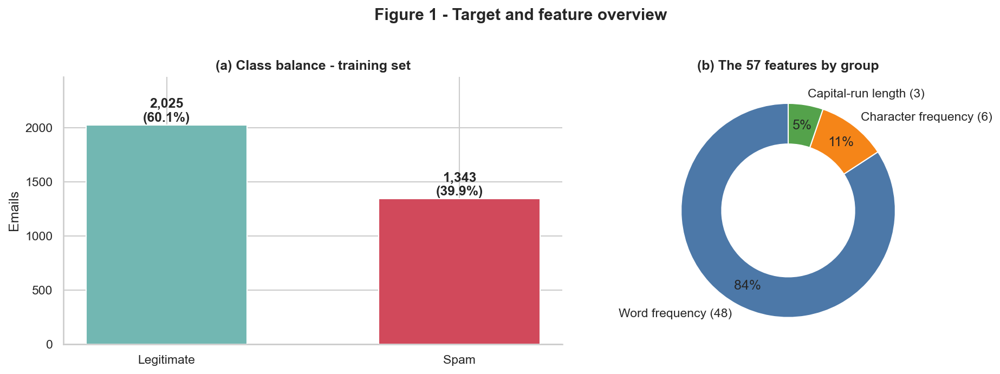
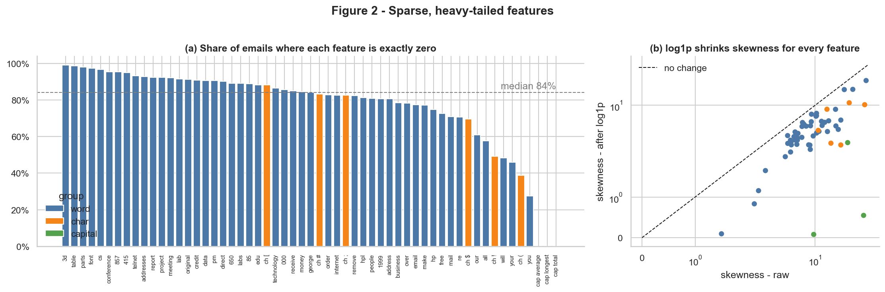
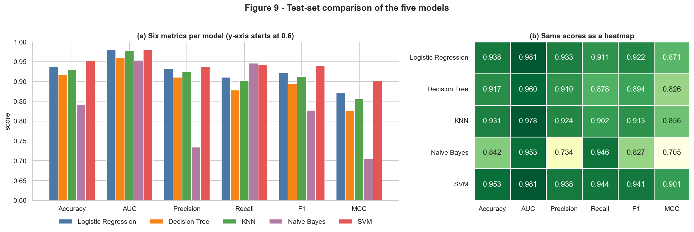
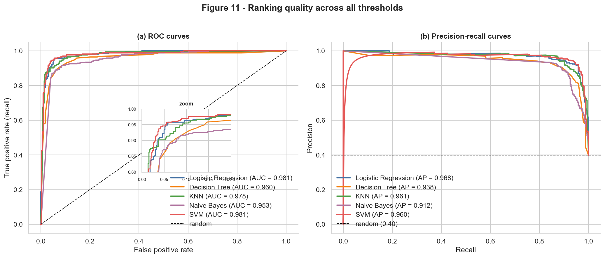
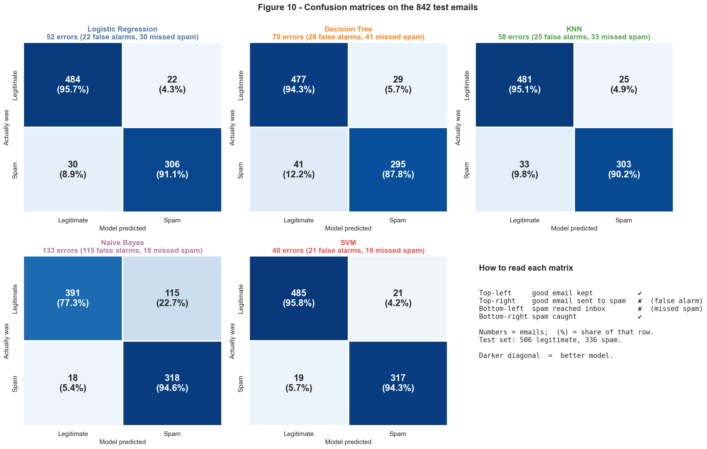
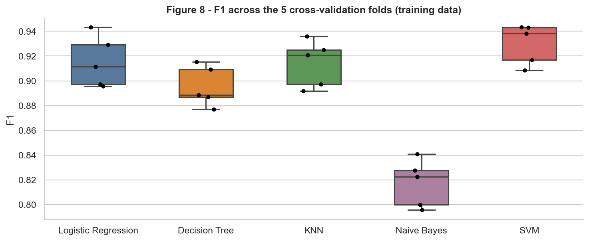
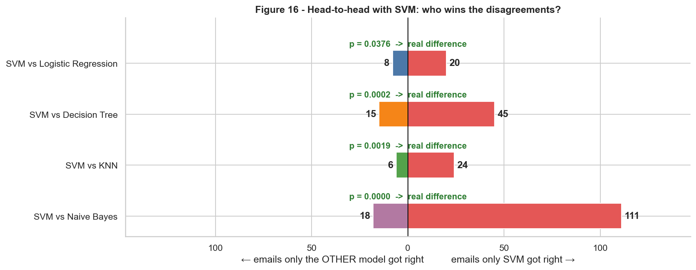
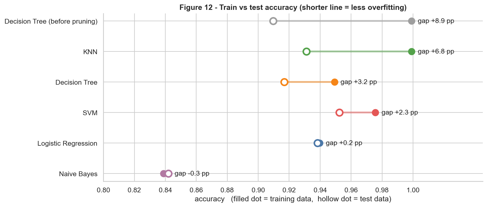
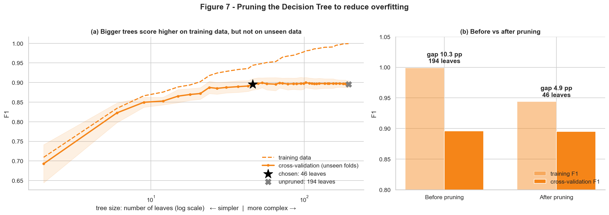

<p align="center"></p>

# Spamurai: Spam Email Classification with Five ML Models

**Spam gets the sword. Real mail gets the inbox.**

Machine Learning, Assignment 2 · M.Tech (AIML), BITS Pilani WILP · Naren (2026AJ05871)

| | |
|---|---|
| **Live Streamlit app** | https://naren-spam-sorting-desk.streamlit.app/ |
| **GitHub repository** | https://github.com/narenstat/ML-Assignment-2-Spam-Detection |
| **Dataset** | [UCI Spambase](https://archive.ics.uci.edu/dataset/94/spambase) |
| **Final model** | Support Vector Machine (RBF kernel): Accuracy 0.9525 · F1 0.9407 · MCC 0.9011 |

---

## a. Problem statement

Spam wastes people's time, but a filter that is too aggressive is just as harmful, because it hides genuine messages in the spam folder. This project builds a classifier that decides whether an email is **spam (1)** or **legitimate (0)**, using 57 numeric features that describe its words, characters and capital letters.

Five classification models are trained on the same data, tuned, and compared on six evaluation metrics. The best model and the other four are then served through an interactive Streamlit web app, which scores held-out test emails without retraining anything.

> **The goal in one line:** catch as much spam as possible **while keeping real email out of the spam folder**, and show the results in a deployed app.

## b. Dataset description

| | |
|---|---|
| **Source** | Spambase, UCI Machine Learning Repository |
| **Size** | 4,601 emails, **57** numeric features, 1 target (assignment minimum: 500 rows, 12 features) |
| **Target** | `spam`: 1 = spam, 0 = legitimate (binary classification) |
| **Quality** | No missing values; 391 exact duplicate rows found and removed |

**From raw data to training and test sets**

| Step | Emails | Legitimate | Spam |
|---|---|---|---|
| Spambase as downloaded | 4,601 | | |
| After removing 391 duplicates | 4,210 | 2,531 (60.1%) | 1,679 (39.9%) |
| Training set (80%, used to learn and tune) | 3,368 | 2,025 (60.1%) | 1,343 (39.9%) |
| Test set (20%, held back for the final check) | 842 | 506 (60.1%) | 336 (39.9%) |

Both sets keep the original 60 / 40 balance, so the test set is a fair miniature of the real data.

**What the 57 features describe**

- **48 word-frequency features:** the percentage of words that are, for example, `free`, `money`, `remove`, `hp` or `meeting`.
- **6 character-frequency features:** the percentage of characters that are `;`, `(`, `[`, `!`, `$` or `#`.
- **3 capital-letter features:** the average, longest and total runs of capital letters.

Every feature is a number. A typical email has values for only a handful of the 57 features; the rest are zero.



### Data preprocessing

1. **Remove duplicates.** 391 identical rows are dropped, so the same email cannot appear in both the training and test sets and inflate the scores.
2. **Stratified 80 / 20 split.** 3,368 emails for training and 842 for testing, with the same spam share in each. The test set is not touched until the final evaluation.
3. **Transform and scale.** `log1p` squashes the extreme values, then `StandardScaler` puts every feature on the same scale. Both steps live **inside each saved model**, so they are learned from training data only and applied automatically in the app. The Decision Tree uses raw values, because it only compares each feature with a threshold.

| Measured on the training data | Value |
|---|---|
| Share of emails with a value of zero, for the typical feature | **84%** |
| Median skewness before → after `log1p` | **9.1 → 4.2** |



> **Why this matters:** KNN measures distances, SVM measures margins and Logistic Regression weighs features against each other. Without these steps, a few emails with thousands of capital letters would dominate every calculation.

## c. GitHub repository link

**https://github.com/narenstat/ML-Assignment-2-Spam-Detection**

```
ML-Assignment-2-Spam-Detection/
├── app.py                                  Streamlit app (Spamurai)
├── requirements.txt                        dependencies for Streamlit Community Cloud
├── README.md                               this file
├── test_data.csv                           842 held-out test emails (57 features + spam)
├── ML_Assignment2_Spambase_Models.ipynb    training and evaluation notebook (run on BITS Virtual Lab)
├── model/
│   ├── logistic_regression.pkl             saved pipelines: preprocessing + trained model
│   ├── decision_tree.pkl
│   ├── knn.pkl
│   ├── naive_bayes.pkl
│   ├── svm.pkl
│   ├── metadata.json                       features, target, file names, tuned settings
│   ├── training_summary.json               cross-validation results and final-model choice
│   └── model_comparison.csv                test-set metrics for all five models
├── figures/                                charts produced by the notebook
├── assets/spamurai.gif                     app mascot animation
└── .streamlit/config.toml                  app theme
```

## d. Models used

All five models use the **same** data and split. Their settings were chosen by **5-fold cross-validation on the training emails only**; the 842 test emails were used once, for the final scores below.

| Model | How it decides | Hyperparameters searched (code) | Best value chosen |
|---|---|---|---|
| Logistic Regression | Weighs the evidence from every feature and adds it up | `C: [0.01, 0.1, 1, 10]`, `max_iter=5000` | **`C = 0.1`**: strong regularisation, kept deliberately simple |
| Decision Tree | Asks a chain of yes/no questions, like a flowchart | `criterion: [gini, entropy]`, `max_depth: [4, 6, 8, 10, 15, None]`, `min_samples_leaf: [1, 3, 5, 10]`, then `ccp_alpha` (~40 values from `cost_complexity_pruning_path`) | **`entropy`, `max_depth = None`, `min_samples_leaf = 1`, `ccp_alpha = 0.00283`**: pruned from 194 to 46 end points |
| K-Nearest Neighbours | Lets the most similar training emails vote | `n_neighbors: [3, 5, 7, 9, 11, 15]`, `weights: [uniform, distance]` | **`n_neighbors = 9`, `weights = distance`**: 9 neighbours, closer ones count more |
| Naive Bayes (Gaussian) | Multiplies the odds from each feature, assuming they are independent | `GaussianNB()` (no search: defaults) | **`var_smoothing = 1e-9`**: default, nothing to tune |
| Support Vector Machine | Draws a curved boundary using many features at once | `kernel = rbf`, `C: [0.5, 1, 5, 10]`, `gamma: [scale, 0.01]`, `probability=True` | **`C = 5`, `gamma = scale`**: flexible boundary, curve width set from the data |

Every search used `GridSearchCV(scoring='f1', cv=StratifiedKFold(n_splits=5, shuffle=True, random_state=42))` on the 3,368 training emails. Preprocessing (`log1p` + `StandardScaler`) sits inside each pipeline, so it is refitted inside every fold. The Decision Tree's pruning strength was chosen by the one-standard-error rule: the simplest tree within one standard error of the best cross-validation score.

### Comparison table (842 test emails, spam = positive class)

| ML Model Name | Accuracy | AUC | Precision | Recall | F1 | MCC |
|---|---|---|---|---|---|---|
| Logistic Regression | 0.9382 | **0.9809** | 0.9329 | 0.9107 | 0.9217 | 0.8709 |
| Decision Tree | 0.9169 | 0.9600 | 0.9105 | 0.8780 | 0.8939 | 0.8260 |
| KNN | 0.9311 | 0.9782 | 0.9238 | 0.9018 | 0.9127 | 0.8560 |
| Naive Bayes | 0.8420 | 0.9533 | 0.7344 | **0.9464** | 0.8270 | 0.7046 |
| Support Vector Machine | **0.9525** | 0.9807 | **0.9379** | 0.9435 | **0.9407** | **0.9011** |

*Bold = best in each column.*

| Metric | In plain words |
|---|---|
| Accuracy | Share of all emails sorted correctly |
| AUC | How well the model ranks spam above real mail (1 = perfect, 0.5 = guessing) |
| Precision | When the model says spam, how often it is right (low = real mail lost) |
| Recall | Share of all spam that the model catches (low = spam reaches the inbox) |
| F1 | One score balancing precision and recall |
| MCC | Overall agreement with the truth, fair even though 60% of emails are legitimate (-1 to 1) |



### How well does each model rank spam? ROC and precision–recall curves

Every model gives each email a spam score. These curves test **every possible cut-off** on that score, which is what the AUC column measures.



| Chart | How to read it | What it shows here |
|---|---|---|
| (a) ROC curve | x-axis: share of real emails wrongly flagged; y-axis: share of spam caught. Hugging the top-left corner is better; the diagonal is random guessing. AUC is the area under the curve. | SVM and Logistic Regression are joint best (AUC 0.981), KNN just behind (0.978). Naive Bayes (0.953) and the Decision Tree (0.960) bend away from the corner earliest. |
| (b) Precision–recall curve | x-axis: share of spam caught; y-axis: how often a spam verdict is right. Higher is better; the dashed line (0.40) is random guessing. | All models stay above 0.9 precision for most of the range; Naive Bayes drops first, matching its many false alarms. AP: LR 0.968, KNN 0.961, SVM 0.960, DT 0.938, NB 0.912. |

> **Takeaway:** SVM, Logistic Regression and KNN are almost equally good at *ranking* emails. SVM's win comes from its *decisions*: at its actual cut-off it makes fewer mistakes, which is why it leads on accuracy, F1 and MCC while AUC is essentially tied.

### Observations on the performance of each model

| ML Model Name | Observation about model performance |
|---|---|
| **Logistic Regression** | **Second-best model overall** (Accuracy 0.9382, F1 0.9217, MCC 0.8709) and the best at ranking emails, with the **highest AUC of all five (0.9809)**. It is also the **most stable**: training and test accuracy differ by only +0.15 pp, because cross-validation chose strong regularisation (C = 0.1). Its 52 mistakes lean towards missed spam (30) rather than false alarms (22). The reason is its straight-line boundary: it adds up each clue separately, so it cannot capture combinations such as `$` together with long runs of capitals, which is where SVM gains its extra 12 correct emails. |
| **Decision Tree** | Grid search first chose an unlimited tree (depth 27, 194 leaves) that **memorised the training data**: 99.9% training accuracy but 91.0% on the test set, an **8.9 pp gap**, the clearest overfitting in this study. **Cost-complexity pruning**, with its strength chosen by cross-validation, cut the tree to 46 leaves and the gap to 3.2 pp, and raised test F1 from 0.8872 to 0.8939. Even so, it ranks **4th** (F1 0.8939, MCC 0.8260) and lets **the most spam through of any model (41)**. Splitting on one feature at a time is a coarse way to combine 57 weak signals, although the tree remains the easiest model to explain. |
| **KNN** | A **solid middle performer**: F1 0.9127, MCC 0.8560 and AUC 0.9782, with 58 mistakes (25 false alarms, 33 missed spam). Its test F1 is almost identical to its cross-validation F1 (0.9141), so it **generalised exactly as predicted**; the near-100% training accuracy is a side effect of distance weighting (every training email is its own closest neighbour), not real overfitting. Its difference from Logistic Regression is **not statistically significant** (McNemar p = 0.391). It is the **costliest to deploy**: it keeps all 3,368 training emails (about 1.5 MB) and compares each new email with every one of them, and it only works this well because the features were log-transformed and scaled. |
| **Naive Bayes** | The **weakest model overall** (Accuracy 0.8420, F1 0.8270, MCC 0.7046), even though it has the **highest recall** of all (0.9464: only 18 spam missed). The catch is precision: it wrongly blocks **115 of 506 legitimate emails (22.7%)**, so only 73% of its "spam" verdicts are right, which would be unacceptable in a real inbox. Its AUC (0.9533) is far higher than its balanced accuracy (0.8596): it ranks emails reasonably, but its probabilities are **over-confident**, because it treats correlated words as independent and counts the same evidence twice. Training and test accuracy are both low (gap -0.32 pp), the signature of **underfitting** rather than overfitting. |
| **Support Vector Machine** | **The best model**: first on Accuracy (0.9525), Precision (0.9379), F1 (0.9407) and MCC (0.9011, **the only score above 0.90**), and second on AUC by just 0.0002. It makes the **fewest mistakes (40)**, split evenly between false alarms (21) and missed spam (19), so it protects real email and catches spam equally well. The RBF kernel learns a curved boundary that combines many cues at once. It also had the **best cross-validation F1 (0.9300)** and a moderate train–test gap (+2.3 pp), so its lead was visible before the test set was used and does not come from memorising. |
| **Overall, winner for this dataset** | **SVM (RBF kernel).** It makes **23% fewer mistakes than the runner-up** (40 vs 52 for Logistic Regression), ranks first on four of six metrics, and was already the best during cross-validation. McNemar's test confirms the lead is **statistically significant against every other model**; for example, it wins 20 of the 28 emails where it and Logistic Regression disagree (p = 0.038). **Logistic Regression is the practical alternative**: nearly the same AUC, a model about 65× smaller and easy-to-read weights, if speed or explainability mattered more than the last 1.4 pp of accuracy. |



### Model-by-model analysis

Each model's six test metrics and confusion matrix are summarised below, followed by what it does well, where it falls short and why.

**#1 (final model) Support Vector Machine: Best overall, and the most balanced**

*What it does well*
- Best accuracy (0.9525), precision (0.9379), F1 (0.9407) and MCC (0.9011): the only MCC above 0.90
- Fewest mistakes (40), split evenly: 21 false alarms, 19 missed spam
- Also the best during cross-validation (F1 0.9300), so the win is not luck

*Where it falls short*
- Larger (about 400 KB) and slower to score than Logistic Regression
- AUC is essentially tied with Logistic Regression (0.9807 vs 0.9809)

**Why:** Its RBF kernel draws a curved boundary, so it can combine cues such as "$" together with long runs of capitals, which a straight line cannot.

**#2 Logistic Regression: A reliable, lightweight runner-up**

*What it does well*
- The highest AUC (0.9809): it ranks emails as well as SVM
- The most stable model: a train–test gap of only +0.15 pp
- Tiny (about 6 KB) and easy to explain through its weights

*Where it falls short*
- 52 mistakes, 12 more than SVM, mostly missed spam (30)
- SVM beats it on the emails where the two disagree: 20 to 8

**Why:** It draws a straight-line boundary, so it adds up each clue separately instead of combining them.

**#3 K-Nearest Neighbours: Solid, but heavy to deploy**

*What it does well*
- F1 0.9127 and AUC 0.9782, close to Logistic Regression
- Performed exactly as cross-validation predicted (0.9141 there, 0.9127 on test)

*Where it falls short*
- 58 mistakes (25 false alarms, 33 missed spam)
- Stores all 3,368 training emails (about 1.5 MB) and compares every new email with all of them

**Why:** It judges an email by its 9 most similar neighbours. Its near-100% training accuracy is a side effect of letting each email count as its own neighbour, not real overfitting.

**#4 Decision Tree (pruned): Easy to explain, but coarse**

*What it does well*
- Pruning fixed its overfitting: the gap fell from 8.9 to 3.2 pp
- Pruning also improved F1 (0.8872 to 0.8939) with a tree 76% smaller

*Where it falls short*
- The most missed spam of all models (41), and 70 mistakes in total
- Lowest precision and recall of the four stronger models

**Why:** It splits on one feature at a time, which is a blunt way to combine 57 weak signals.

**#5 Naive Bayes (Gaussian): Catches spam, but blocks far too much real mail**

*What it does well*
- The highest recall (0.9464): only 18 spam emails got through

*Where it falls short*
- Blocks 115 of 506 real emails (22.7%), almost one in four
- Lowest accuracy (0.8420), F1 (0.8270) and MCC (0.7046)

**Why:** It assumes every feature is independent, so related words are counted as separate evidence. Its scores become over-confident, and too many real emails cross the spam line. Train and test accuracy are both low (gap -0.32 pp): it underfits.

### Why SVM is the winner: the evidence

Five questions an evaluator might ask, each answered with a chart. Charts with a **gold** label use the training data (when the model was chosen); charts with a **teal** label use the 842 test emails (the final check).

**1. Was SVM already the best before it saw the test emails?**



- During training, each model was scored 5 times on different slices of the training emails. Each dot is one slice; the box shows the middle of the five scores.
- SVM had the best average F1 (0.9300) and its worst slice (about 0.91) was as good as Logistic Regression's typical one. Naive Bayes sits far below the rest on every slice.
- The ranking on the test emails is exactly the same: SVM > Logistic Regression > KNN > Decision Tree > Naive Bayes.

> **Takeaway:** SVM was chosen on the training data alone, and the test set confirmed the choice.

**2. Which model makes the mistakes that matter most?**


- A **false alarm** (a real email sent to spam) is usually worse for a user than one spam reaching the inbox.
- SVM makes the fewest mistakes (40) and only 21 false alarms (4.2% of real email).
- Naive Bayes makes 115 false alarms: it would hide almost one in four genuine emails.

> **Takeaway:** SVM is the best at the mistake users care most about, not just on average.

**3. Catching spam or protecting real mail: who balances both?**

- The best place on this chart is the top-right corner: high recall and high precision.
- Naive Bayes catches the most spam (far right) but has by far the lowest precision (bottom).
- SVM sits closest to the ideal corner, which is why it has the best F1 and MCC.

> **Takeaway:** Recall alone would wrongly favour Naive Bayes. F1 and MCC measure both sides, and SVM wins on both.

**4. Is SVM's lead real, or could it be luck?**



- McNemar's test looks only at the emails where two models disagree. If they were equally good, each would win about half.
- SVM wins those disagreements 20 to 8 against Logistic Regression, 45 to 15 against the Decision Tree, 24 to 6 against KNN and 111 to 18 against Naive Bayes.
- Every p-value is below 0.05, meaning there is less than a 5% chance these leads are luck. By contrast, Logistic Regression vs KNN gives p = 0.391: those two are genuinely tied.

> **Takeaway:** SVM's advantage is statistically real against every other model.

**5. Did any model just memorise the training data?**




- A big gap between training and test accuracy means a model memorised examples instead of learning patterns.
- The unpruned Decision Tree had the biggest gap (8.9 pp). Pruning cut it to 3.2 pp and made the tree 76% smaller.
- SVM (+2.3 pp) and Logistic Regression (+0.15 pp) generalise well. Naive Bayes is low on both sides: it underfits.

> **Takeaway:** SVM's test score is trustworthy: it is not the result of memorising the training emails.

### Final verdict

**Support Vector Machine (RBF kernel).** Best during training **and** on the test emails, the fewest mistakes (40), the fewest false alarms (21), and a lead that is statistically real. It is the model Spamurai uses as its final model.

**The trade-off.** SVM is larger (about 400 KB) and slower to score than Logistic Regression (about 6 KB), which ranks emails almost as well. If speed or explainability mattered more than accuracy, Logistic Regression would be the sensible choice. For a spam filter, losing fewer genuine emails is worth the extra size.

**Limits of this study**
- All results come from one 80 / 20 split. Cross-validation agreeing with the test results makes split luck unlikely, but not impossible.
- Every model uses its default decision cut-off. Moving it would trade precision against recall.
- Spambase's legitimate emails come from one company's mailbox, so words like "hp" and "george" strongly signal real mail here but would not for other people.

---

## Streamlit app: Spamurai

**Live app:** https://naren-spam-sorting-desk.streamlit.app/

| Assignment requirement | Where it is in the app |
|---|---|
| a. Dataset upload option (CSV) | Sidebar, step 1: *Upload a CSV file* (with a download button for `test_data.csv`) |
| b. Model selection dropdown | Sidebar, step 2: *Choose a model* (all five models) |
| c. Display of evaluation metrics | *Evaluation metrics* card: Accuracy, AUC, Precision, Recall, F1, MCC, with each model's rank |
| d. Confusion matrix / classification report | Both: the confusion matrix trays and the *Classification report* tab |
| Results of all models on the test data | *Compare all five* and *Why SVM?* tabs |
| No retraining | The app only loads `model/*.pkl` and scores the emails |

**How to use it:** choose the emails (sidebar, step 1), choose a model (step 2), then open the folder tabs. The *Download the SVM report* button gives a 5-page PDF of the evidence.

**If the app shows a "Zzzz" sleep screen:** Streamlit's free hosting pauses apps that have had no visitors for a while. Nothing is broken and nothing is lost. Click **Yes, get this app back up!**, wait about 1 minute while it restarts, and the app opens on the final-model results.

## Execution on BITS Virtual Lab

The notebook was executed end to end on the BITS Virtual Lab (Python 3.11, scikit-learn 1.2.1). Its first cell records the lab user (`s2026aj05871`), working folder and run time. The app was also run in the lab with `streamlit run app.py`.

## How to run locally

```bash
git clone https://github.com/narenstat/ML-Assignment-2-Spam-Detection.git
cd ML-Assignment-2-Spam-Detection
conda create -n spamurai python=3.11 -y && conda activate spamurai
python -m pip install -r requirements.txt
python -m streamlit run app.py
```
Then open http://localhost:8501. Python 3.11 matters: the pinned scikit-learn and numpy versions match the ones the models were saved with.
